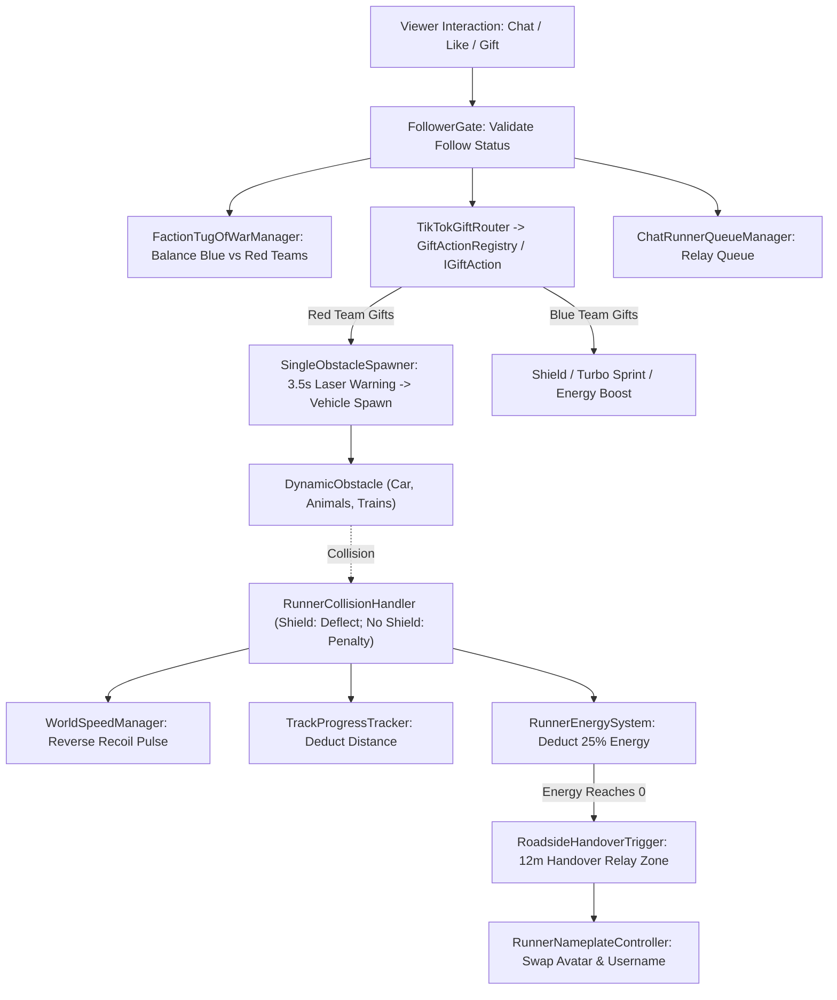

# 📖 SOURCE CODE ARCHITECTURE GUIDE

> **Project:** StreamRushLive (Team 2) — TikTok Live Interactive 3-Lane Endless Runner  
> **Standardized Version:** **v0.3** (`Prototype chatland.unity`)  
> **Core Design Principles:**  
> 1. **Treadmill Runner Model:** The runner remains fixed at the running axis (X = 9.55m), while the world (road tiles, city streets, obstacles) scrolls backward to create forward motion.  
> 2. **No Health / Endless Relay:** The runner never permanently dies from collisions. Collisions apply physical disruption (runner pushback, reverse world scroll impulse, distance penalty, energy loss). The livestream is a continuous, endless relay stream.  
> 3. **3-Lane Highway:** Left Lane (Z = +3.0m), Middle Lane (Z = 0.0m), Right Lane (Z = -3.0m).  
> 4. **Decoupled Modular Architecture:** Communication between modules is mediated via `EventBus` without rigid cross-references.  
> 5. **Command Pattern for Gifts:** All TikTok gift interactions are encapsulated within independent `IGiftAction` instances.

---

## 🗺️ MAIN DIRECTORY STRUCTURE

```
Assets/_Project/Scripts/
├── Core/                     # Shared foundation systems (EventBus, Energy, World Speed, Gift Manager)
├── Features/
│   ├── Gifts/                # Stream Gift Architecture: IGiftAction, Registry, and Concrete Actions
│   ├── Runner/               # Character control, treadmill physics, collisions, roadside handover
│   ├── Spawning/             # Dynamic obstacle spawning (DynamicObstacle), Base Classes (ObstacleBase)
│   ├── StreamIntegration/   # Livestream integration (Blue vs Red teams, TikTokGiftRouter, Socket Client)
│   ├── Track/               # Track distance progress, 16 city street tiles looper, environment items
│   └── UI/                  # HUD Management, Progress Bar, 3D Nameplate, Popups, Toasts, PreGame Config
├── Demo/                     # [MOCK & TESTING] Live simulation bots, chat console test, debug panel
├── Editor/                   # Unity Editor tools and extensions
└── Legacy_v0.2/             # [ARCHIVED] Deprecated legacy scripts from v0.2
```

---

## 1. `Core/` — SHARED FOUNDATION SYSTEMS

| Script Name | Role & Core Responsibilities |
| :--- | :--- |
| **`EventBus.cs`** | **Decoupled Static Publish / Subscribe System.** Enables cross-module event messaging without direct component coupling (e.g., when Red Team reaches threshold energy, `FactionTugOfWarManager` publishes `RequestCarSpawnEvent`, which `ChatRunnerCarSpawnAdapter` receives to request obstacle spawning). |
| **`RunnerEnergySystem.cs`** | **Runner Stamina / Energy System (Team Blue).** Energy does not passively drain over time or during Sprint boosts. Instead, changing lanes consumes stamina (default -10 energy) and vehicle collisions inflict an energy penalty (-25%). Publishes `OnEnergyNormalizedChanged` for HUD updates. (Includes backwards-compatible alias `EnergySystem`). |
| **`WorldSpeedManager.cs`** | **World Scroll Speed Controller.** Governs base scroll speed (8.0 m/s), Sprint boost (18.0 m/s), slide deceleration, and smooth acceleration recovery. Provides `TriggerReverseWorldKnockback(peakSpeed: -8.5m/s)` to apply an instant backward recoil pulse to the environment upon severe collisions. |
| **`GiftManager.cs`** | **Central Gift Configuration Facade.** Maintains and provides parameters for active gift durations (Shield 15s, Sprint 30s, Unlimited Cars 60s), energy costs, and vehicle impact properties. |

---

## 2. `Features/Gifts/` — GIFT ARCHITECTURE (IGIFTACTION PATTERN)

| Script Name | Role & Core Responsibilities |
| :--- | :--- |
| **`IGiftAction.cs`** | **Standard Interface Contract** for all gift actions and `GiftContext` DTO (containing sender information, faction, coin value, and necessary runtime service references). |
| **`GiftActionRegistry.cs`** | **Central Lookup Registry.** Maps `GiftActionType` to concrete `IGiftAction` classes, enabling new gifts to be introduced without modifying router logic. |
| **`Actions/BlueGiftActions.cs`** | Gift actions for Team Blue: `ShieldGiftAction` (Protective Shield), `SpeedBoostGiftAction` (Turbo Sprint), `FreeControlGiftAction` (Free Control Buff), `BlueEnergyBottleGiftAction` (+300 Blue Energy). |
| **`Actions/RedGiftActions.cs`** | Gift actions for Team Red: `SpawnPickupTruckGiftAction` (Tier 2 Hunting Beast phase), `SpawnHeavyTruckGiftAction` (Tier 3 Train phase), `UnlimitedCarsGiftAction` (Unlimited Car Storm 60s), `RedEnergyBottleGiftAction` (+500 Red Energy). |
| **`Actions/SpecialGiftActions.cs`** | Special actions: `GiftDanceAction` (Celebration dance), `RainHazardGiftAction` (Rain storm & slippery track), `VipRelayTicketGiftAction` (VIP relay queue pass), `FollowRunnerGiftAction` (Follower becomes next runner), `LikeEnergyGiftAction` (Like points recharge). |

---

## 3. `Features/Runner/` — RUNNER CONTROL & LOCOMOTION PHYSICS

| Script Name | Role & Core Responsibilities |
| :--- | :--- |
| **`ChatLaneRunnerController.cs`** | **Viewer Chat Command Dispatcher.** Parses chat commands (`1`, `2`, `3`, `left`, `right`, `jump`), validates action energy requirements (`RunnerEnergySystem` or `FactionTugOfWarManager`), handles Free Control and Sprint modes, and delegates locomotion execution to `RunnerMovement`. |
| **`RunnerMovement.cs`**<br>*(formerly `RunnerController`)* | **Single Source of Truth for Runner Physics & Locomotion.** Handles lane shifting across 3 lanes (`MoveToLane`, `ShiftLane` on Z: +3m, 0m, -3m), jump/fall on the Y axis, knockback push on X (`ApplyKnockback`), and **Forgiving Hitbox** logic (shrinks collider ~15% relative to visible mesh at Awake). Includes backwards-compatible alias `RunnerController`. |
| **`RunnerCollisionHandler.cs`** | **Collision Resolution Center.** When hitting an obstacle: if shielded, deflects/destroys the obstacle while maintaining distance. If unshielded, simultaneously triggers distance penalty, energy loss (-25%), reverse world knockback, and 2.0s invulnerability frames (i-Frames) with visual blinking. |
| **`RunnerInputHandler.cs`** | **Local Keyboard Input Reader (Streamer / Developer Manual Controls).** Supports lane shifting via A/D, Left/Right arrow keys, or 1/2/3 keys; Space key to Jump. Automatically suppresses input when any input field (`TMP_InputField`) is focused. |
| **`RoadsideHandoverTrigger.cs`** | **Roadside Relay Handover Trigger.** A 12m trigger spanning all 3 lanes; when a runner runs out of stamina and passes the roadside proxy, it triggers `ChatRunnerQueueManager.NotifyRunnerReachedProxy()` to seamlessly transfer the runner baton and swap avatar/nameplate. |
| **`RunnerGiftEffects.cs`** | **Runner Buff State Manager.** Manages duration for active Shield buff, High Jump buff, and consumes shield upon obstacle impact. |
| **`GiftDanceController.cs`** | **Celebration Dance Animator Controller.** Blends the `Dance` animator layer weight when viewers send special gifts or when the runner crosses the finish line. |

---

## 4. `Features/Spawning/` — OBSTACLE & ITEM SPAWNING

### 4.1. Polymorphic Base Classes & Enums
* **`ObstacleBase.cs` [ABSTRACT CLASS]:** Base class for all obstacles. Defines energy loss percentage (`EnergyPenaltyPercent`), distance penalty (`DistancePenaltyMeters`), hitstop freeze duration (`HitStopDuration`), collision deduplication flag (`HasCollided`), and shield deflection logic (`_isShieldDeflected`).
* **`ItemBase.cs` [ABSTRACT CLASS]:** Base class for collectible items. Defines `Collect(GameObject runner)`.
* **`ObstacleType.cs` [ENUM]:** Core dynamic obstacle types for Team Red: `Car` (Sedan - Tier 1), `Animals` (Hunting Beast - Tier 2), `Trains` (Train / Heavy Truck - Tier 3). (Includes backwards-compatible alias `VehicleTier`).

### 4.2. Concrete Spawners & Obstacles
| Script Name | Role & Core Responsibilities |
| :--- | :--- |
| **`SingleObstacleSpawner.cs`** | **Intelligent 3-Lane Spawner.** Spawns obstacles for Team Red (`Car`, `Animals`, `Trains`) across lanes Z = +3, 0, -3. Displays a **3.5s flashing red laser warning** prior to arrival. Enforces active obstacle caps to guarantee at least one clear evasion lane. |
| **`DynamicObstacle.cs`**<br>*(inherits `ObstacleBase`)* | **Autonomous Head-On Moving Obstacles (Car, Animals, Trains).** Features standalone forward velocity compounded with world scroll speed, plays vehicle horns, and deflects away when striking a shielded runner. |
| **`BuffItem.cs`** | **Energy Buff Item.** Dropped by viewers; restores **+20% Stamina** to the runner upon collection. |

---

## 5. `Features/StreamIntegration/` — LIVESTREAM & FACTION LOGIC

| Script Name | Role & Core Responsibilities |
| :--- | :--- |
| **`TikTokGiftRouter.cs`** | **Standardized TikTok Gift Router.** Packages incoming gifts into `GiftContext` and invokes `GiftActionRegistry` to execute effects while triggering UI card bounce/highlighting. |
| **`FactionTugOfWarManager.cs`** | **Blue vs Red Tug-of-War Coordinator.** Coordinates balance between the two `FactionEnergyPool` instances (Blue vs Red). Faction assignment is driven by chat commands (`blue`/`red`) or gift donations. When Red Pool reaches 100%, automatically spawns an incoming vehicle. |
| **`FactionEnergyPool.cs`** | **Shared Energy Reservoir.** Reusable component for both Team Blue (Runner support) and Team Red (Obstacle summons). Stores, increments, decrements, and normalizes faction percentage points. |
| **`FollowerGate.cs`** | **Follower Permission Gatekeeper.** Ensures only users who have followed the livestream channel can issue gameplay commands (lane changes, queueing for relay runs). |
| **`ChatRunnerCarSpawnAdapter.cs`** | **Car Spawn Event Adapter.** Listens for `RequestCarSpawnEvent` from `EventBus` when Team Red accumulates enough energy, invoking `SingleObstacleSpawner.TriggerSpawnObstacleFromRedEnergy()` directly. |
| **`ChatCommandSanitizer.cs`** | **Chat Command Sanitizer.** Normalizes input strings by converting to lowercase and stripping punctuation/whitespace for accurate parsing. |

---

## 6. `Demo/` — SIMULATION & DEBUG TESTING (ISOLATED)

| Script Name | Role & Core Responsibilities |
| :--- | :--- |
| **`LiveSessionDemoRunner.cs`** | Automated bot simulating an active livestream session (auto-likes, lane changes, Blue/Red gifts) for standalone testing without requiring a live TikTok broadcast. |
| **`MockChatConsole.cs`** | Chat UI console allowing developers to input viewer commands directly, alongside debug hotkeys: `F1` (Shield), `F2` (Sprint), `F3` (Red Car Spawn). |
| **`MockDebugUIPanel.cs`** | On-screen debug panel providing quick action buttons: Add Follower, Inject 100 Energy, Spawn Vehicles. |
| **`MockRunnerActionHandler.cs`** | Handles simulated actions for test runners and faction energy adjustments. |

---

## 7. GAMEPLAY DATA PIPELINE



---
*This architecture guide standardizes the codebase for v0.3. When creating new scripts, place them in their respective feature folders and document their core responsibilities accordingly.*
