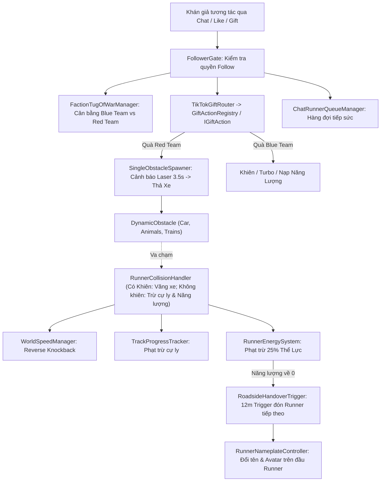

# 📖 HƯỚNG DẪN KIẾN TRÚC MÃ NGUỒN (SCRIPTS ARCHITECTURE GUIDE)

> **Dự án:** StreamRushLive (Team 2) — TikTok Live Interactive 3-Lane Endless Runner  
> **Phiên bản chuẩn hóa:** **v0.3** (`Prototype chatland.unity`)  
> **Nguyên tắc thiết kế cốt lõi:**  
> 1. **Mô hình Treadmill Runner:** Runner đứng cố định tại trục chạy (X = 9.55m), thế giới (mặt đường, dãy phố, vật cản) cuộn ngược chiều tạo cảm giác di chuyển.  
> 2. **Không có cơ chế Máu / Game Over (No HP / Endless Relay):** Runner không bao giờ chết vì va chạm; va chạm chỉ gián đoạn vật lý (đẩy lùi Runner, xung cuộn ngược thế giới, trừ cự ly, trừ năng lượng). Buổi livestream là một luồng chạy tiếp sức vô tận liên tục.  
> 3. **Xa lộ 3 làn xe:** Làn Trái (Z = +3.0m), Làn Giữa (Z = 0.0m), Làn Phải (Z = -3.0m).  
> 4. **Kiến trúc Modul Decoupled:** Giao tiếp qua `EventBus`, không tham chiếu chéo phụ thuộc chặt chẽ giữa các module.  
> 5. **Command Pattern cho Quà Tặng:** Toàn bộ hành vi quà tặng TikTok được chuẩn hóa qua `IGiftAction` độc lập.

---

## 🗺️ SƠ ĐỒ PHÂN BỔ THƯ MỤC CHÍNH

```
Assets/_Project/Scripts/
├── Core/                     # Hệ thống nền tảng dùng chung (EventBus, Năng lượng, Vận tốc thế giới, Quản lý quà)
├── Features/
│   ├── Gifts/                # Kiến trúc Quà tặng Stream: IGiftAction, Registry, và các Concrete Actions
│   ├── Runner/               # Điều khiển nhân vật, vật lý thảm chạy, va chạm, đón gậy tiếp sức ven đường
│   ├── Spawning/             # Sinh chướng ngại vật động (DynamicObstacle), Base Classes (ObstacleBase)
│   ├── StreamIntegration/   # Tích hợp livestream (Đội Xanh vs Đội Đỏ, TikTokGiftRouter, Socket Client)
│   ├── Track/               # Theo dõi cự ly, trôi 16 Tiles phố, vật thể thế giới
│   └── UI/                  # Quản trị HUD, Thanh tiến trình, Bảng tên 3D, Popup, Toast, PreGame Config
├── Demo/                     # [MOCK & TESTING] Các script mô phỏng live, console test, debug panel
├── Editor/                   # Tiện ích mở rộng Unity Editor
└── Legacy_v0.2/             # [LƯU TRỮ NỘI BỘ] Các script cũ thuộc cơ chế v0.2 đã bãi bỏ
```

---

## 1. THƯ MỤC `Core/` — HỆ THỐNG NỀN TẢNG DÙNG CHUNG

| Tên Script | Vai trò & Trách nhiệm chính |
| :--- | :--- |
| **`EventBus.cs`** | **Hệ thống Publish / Subscribe tĩnh Decoupled.** Cho phép các module giao tiếp mà không cần tham chiếu trực tiếp nhau. Ví dụ: Khi phe Đỏ (Red Team) đủ điểm/năng lượng, `FactionTugOfWarManager` phát `RequestCarSpawnEvent`, `ChatRunnerCarSpawnAdapter` lắng nghe và yêu cầu Spawner thả xe. |
| **`RunnerEnergySystem.cs`** | **Hệ thống quản lý Thể lực/Năng lượng của Runner (Team Blue).** Năng lượng không tự tiêu hao theo thời gian và không trừ khi bứt tốc (Sprint là miễn phí). Thay vào đó, mỗi khi Runner đổi làn sẽ bị trừ năng lượng (mặc định -10 điểm) và bị phạt khi va chạm (-25%). Phát sự kiện `OnEnergyNormalizedChanged` cập nhật thanh năng lượng trên HUD. (Có alias tương thích ngược `EnergySystem`). |
| **`WorldSpeedManager.cs`** | **Bộ điều phối vận tốc của toàn bộ thế giới cuộn.** Điều chỉnh tốc độ cơ bản (8.0 m/s), bứt tốc Sprint (18.0 m/s), hãm trượt Slide, và hồi phục gia tốc mượt mà. Sở hữu hàm `TriggerReverseWorldKnockback(peakSpeed: -8.5m/s)` tạo xung lực cuộn ngược toàn bộ phố xá khi có va chạm mạnh. |
| **`GiftManager.cs`** | **Dịch vụ Facade trung tâm cung cấp thông số cấu hình quà tặng.** Lưu trữ và cung cấp thời lượng hiệu lực của Khiên (15s), Tăng tốc (30s), Bão xe (60s), chi phí năng lượng và các thông số knockback/sát thương xe. |

---

## 2. THƯ MỤC `Features/Gifts/` — KIẾN TRÚC QUÀ TẶNG (IGIFTACTION PATTERN)

| Tên Script | Vai trò & Trách nhiệm chính |
| :--- | :--- |
| **`IGiftAction.cs`** | **Hợp đồng Interface chuẩn** cho mọi hành vi quà tặng và DTO `GiftContext` (chứa dữ liệu người gửi, phe phái, số coin, và các tham chiếu dịch vụ cần thiết). |
| **`GiftActionRegistry.cs`** | **Registry tra cứu trung tâm.** Ánh xạ giữa `GiftActionType` sang các class thực thi `IGiftAction`, cho phép mở rộng quà mới mà không cần sửa code router. |
| **`Actions/BlueGiftActions.cs`** | Các hành động quà tặng cho Đội Xanh: `ShieldGiftAction` (Khiên), `SpeedBoostGiftAction` (Tăng tốc Turbo), `FreeControlGiftAction` (Miễn phí điều khiển), `BlueEnergyBottleGiftAction` (+300 Năng lượng Xanh). |
| **`Actions/RedGiftActions.cs`** | Các hành động quà tặng cho Đội Đỏ: `SpawnPickupTruckGiftAction` (Pha thú săn Tier 2), `SpawnHeavyTruckGiftAction` (Pha xe lửa Tier 3), `UnlimitedCarsGiftAction` (Bão xe không giới hạn 60s), `RedEnergyBottleGiftAction` (+500 Năng lượng Đỏ). |
| **`Actions/SpecialGiftActions.cs`** | Các hành động đặc biệt: `GiftDanceAction` (Vũ đạo ăn mừng), `RainHazardGiftAction` (Mưa trơn trượt), `VipRelayTicketGiftAction` (Vé chạy tiếp sức VIP), `FollowRunnerGiftAction` (Follow thành Runner), `LikeEnergyGiftAction` (Nạp điểm like). |

---

## 3. THƯ MỤC `Features/Runner/` — ĐIỀU KHIỂN & VẬT LÝ NHÂN VẬT

| Tên Script | Vai trò & Trách nhiệm chính |
| :--- | :--- |
| **`ChatLaneRunnerController.cs`** | **Bộ tiếp nhận & phân phối lệnh Chat của Runner.** Tiếp nhận và phân tích cú pháp lệnh từ người xem (`1`, `2`, `3`, `left`, `right`, `jump`, `slide`), kiểm tra năng lượng điều khiển (`RunnerEnergySystem` hoặc `FactionTugOfWarManager`), kích hoạt chế độ Điều Khiển Tự Do / Sprint Buff, và gọi ủy quyền toàn bộ lệnh di chuyển sang `RunnerMovement`. |
| **`RunnerMovement.cs`**<br>*(tên cũ: `RunnerController`)* | **"Bộ não" vật lý & chuyển động độc quyền của Runner.** Nguồn chân lý duy nhất (Single Source of Truth) thực thi di chuyển vật lý: chuyển 3 làn đường mượt mà (`MoveToLane`, `ShiftLane` trên trục Z: +3m, 0m, -3m), nhảy/rơi/cúi đầu trên trục Y, lực đẩy lùi X (`ApplyKnockback`), và **Forgiving Hitbox** (co nhỏ Collider 15% so với Mesh thật lúc Awake). Có alias tương thích ngược `RunnerController`. |
| **`RunnerCollisionHandler.cs`** | **Trung tâm tiếp nhận & giải quyết va chạm.** Khi chạm vật cản: nếu có Khiên (`Shield`) -> hủy vật cản, bảo toàn cự ly. Nếu không có Khiên -> kích hoạt đồng thời: trừ cự ly tiến trình, trừ năng lượng (-25%), kích hoạt cuộn ngược thế giới (`Reverse World Knockback`), và bật 2.0s nhấp nháy bất tử (`i-Frames`). |
| **`RunnerInputHandler.cs`** | **Bộ đọc phím bàn phím cục bộ (Dành cho Developer/Streamer tự lái).** Hỗ trợ đổi làn bằng phím A/D, Mũi tên Trái/Phải hoặc 1/2/3; Space để Nhảy; S để Trượt. Tự động vô hiệu hóa phím bấm khi con trỏ chuột đang nằm trong ô nhập text (`TMP_InputField`). |
| **`RoadsideHandoverTrigger.cs`** | **Bộ kích hoạt đổi người tiếp sức ven đường.** Vùng Trigger 12m bao phủ cả 3 làn đường; khi Runner hết năng lượng chạy ngang qua mốc lề đường sẽ bắt va chạm và gọi `ChatRunnerQueueManager.NotifyRunnerReachedProxy()` để đổi avatar và người chạy mới mượt mà. |
| **`RunnerGiftEffects.cs`** | **Quản lý trạng thái hiệu ứng Buff trên Runner.** Theo dõi thời gian duy trì của Khiên bảo vệ (`Shield`), hiệu ứng Nhảy cao (`High Jump`), và tiêu thụ khiên khi có va chạm. |
| **`GiftDanceController.cs`** | **Hoạt ảnh vũ đạo ăn mừng.** Điều khiển trọng số Weight của Animator layer `Dance` khi người xem gửi quà tặng đặc biệt hoặc khi Runner chạm vạch đích. |

---

## 4. THƯ MỤC `Features/Spawning/` — SINH VẬT CẢN & CHƯỚNG NGẠI VẬT

### 4.1. Các Lớp Cơ Sở Đa Hình (Base Classes & Enums) — Tuyệt đối không xóa!
* **`ObstacleBase.cs` [ABSTRACT CLASS]:** Lớp cha trừu tượng của toàn bộ chướng ngại vật trong game. Quy định sẵn phần trăm trừ năng lượng (`EnergyPenaltyPercent`), cự ly bị trừ (`DistancePenaltyMeters`), thời gian đóng băng khung hình (`HitStopDuration`), cờ chống va chạm trùng lặp (`HasCollided`), và cơ chế bị phản xạ khi Runner có khiên (`_isShieldDeflected`).
* **`ItemBase.cs` [ABSTRACT CLASS]:** Lớp cha trừu tượng của các vật phẩm có thể nhặt. Định nghĩa hàm thu thập `Collect(GameObject runner)`.
* **`ObstacleType.cs` [ENUM]:** Định nghĩa 3 loại chướng ngại vật động cốt lõi của phe Đỏ (Red Team): `Car` (Xe ô tô - Tier 1), `Animals` (Thú săn cản đường - Tier 2), `Trains` (Tàu hỏa / Xe siêu trường - Tier 3). (Kèm alias tương thích ngược `VehicleTier`).

### 4.2. Các Script Vật Cản & Spawner Thực Thi
| Tên Script | Vai trò & Trách nhiệm chính |
| :--- | :--- |
| **`SingleObstacleSpawner.cs`** | **Spawner thông minh 3 làn xe.** Sinh chướng ngại vật cho phe Đỏ (`Car`, `Animals`, `Trains`) theo làn Z = +3, 0, -3. Có dải **Laser đỏ nhấp nháy cảnh báo trước 3.5 giây**. Giới hạn tối đa số vật cản cùng lúc để luôn đảm bảo có ít nhất 1 làn trống cho Runner né. |
| **`DynamicObstacle.cs`**<br>*(kế thừa: `ObstacleBase`)* | **Chướng ngại vật động tự hành ngược chiều (Car, Animals, Trains).** Kế thừa từ `ObstacleBase`. Sở hữu vận tốc chạy tự thân độc lập cộng dồn với tốc độ thế giới lao về phía Runner, phát âm thanh còi xe, và bị hất văng khi trúng Khiên của Runner. |
| **`BuffItem.cs`** | **Vật phẩm Bình Năng Lượng.** Do khán giả thả xuống; hồi phục ngay **+20% Năng Lượng** cho Runner. |

---

## 5. THƯ MỤC `Features/StreamIntegration/` — TÍCH HỢP LIVESTREAM & PHE PHÁI

| Tên Script | Vai trò & Trách nhiệm chính |
| :--- | :--- |
| **`TikTokGiftRouter.cs`** | **Bộ định tuyến quà tặng TikTok chuẩn hóa.** Đóng gói ngữ cảnh `GiftContext` và ủy quyền thực thi cho `GiftActionRegistry` để kích hoạt quà tặng, đồng thời kích hoạt hiệu ứng nhún (highlight) thẻ quà trên UI. |
| **`FactionTugOfWarManager.cs`** | **Trọng tài điều phối Kéo co (Đội Xanh vs Đội Đỏ / Blue vs Red).** Quản lý tỷ lệ giữa 2 kho năng lượng `FactionEnergyPool` (Blue vs Red). Phân chia khán giả theo cú pháp chat (`blue`/`red`) hoặc quà tặng. Khi Red Pool đầy 100%, tự động kích hoạt thả xe cản đường. |
| **`FactionEnergyPool.cs`** | **Bình chứa năng lượng chuẩn hóa dùng chung.** Được tái sử dụng độc lập cho cả Team Blue (Hỗ trợ Runner) và Team Red (Thử thách vật cản). Đảm nhiệm lưu trữ, cộng, trừ điểm và tính toán tỷ lệ % năng lượng cho từng phe. |
| **`FollowerGate.cs`** | **Cổng kiểm soát quyền hạn Follower.** Đảm bảo chỉ những tài khoản đã bấm Follow kênh livestream mới có quyền can thiệp vào game (gửi lệnh chuyển làn, xếp hàng chạy tiếp sức). |
| **`ChatRunnerCarSpawnAdapter.cs`** | **Bộ chuyển đổi sự kiện thả xe.** Lắng nghe `RequestCarSpawnEvent` từ `EventBus` khi phe Đỏ đủ điểm, rồi gọi trực tiếp `SingleObstacleSpawner.TriggerSpawnObstacleFromRedEnergy()` để sinh xe trên đường. |
| **`ChatCommandSanitizer.cs`** | **Bộ chuẩn hóa chuỗi lệnh chat.** Tự động chuyển ký tự về chữ thường, cắt bỏ khoảng trắng thừa và dấu câu để bộ phân tích lệnh nhận diện chính xác. |

---

## 6. THƯ MỤC `Demo/` — MÔ PHỎNG & DEBUG TESTING (TÁCH BIỆT)

| Tên Script | Vai trò & Trách nhiệm chính |
| :--- | :--- |
| **`LiveSessionDemoRunner.cs`** | Bot tự động mô phỏng toàn bộ luồng phòng live stream (tự động Like, Chat chuyển làn, Donate quà Blue/Red) để test game mà không cần mở TikTok thật. |
| **`MockChatConsole.cs`** | Khung chat UI cho phép gõ trực tiếp lệnh của khán giả, kết hợp các phím tắt nhanh: `F1` (Khiên), `F2` (Sprint), `F3` (Thả xe Đội Đỏ). |
| **`MockDebugUIPanel.cs`** | Bảng UI nút bấm góc màn hình hỗ trợ bấm nhanh: Thêm Follower, Bơm 100 năng lượng, Thả các loại xe. |
| **`MockRunnerActionHandler.cs`** | Xử lý các hành vi giả lập cho runner chạy thử và thao tác năng lượng hai phe. |

---

## 7. QUY TRÌNH LUỒNG DỮ LIỆU CHÍNH (GAMEPLAY PIPELINE)



---
*Tài liệu này được biên soạn chuẩn hóa cho kiến trúc mã nguồn v0.3. Khi thêm script mới vào dự án, hãy đặt vào đúng thư mục chuyên trách tương ứng và cập nhật bảng giải thích tại đây.*
